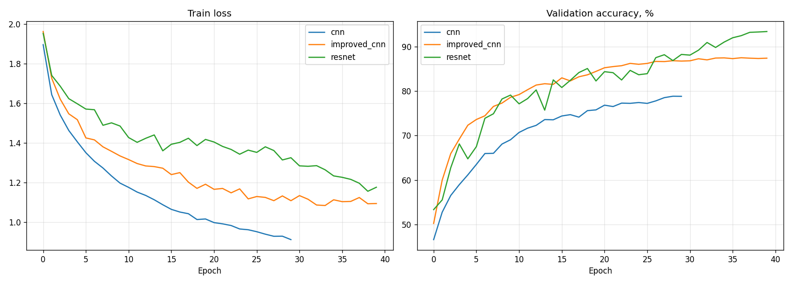
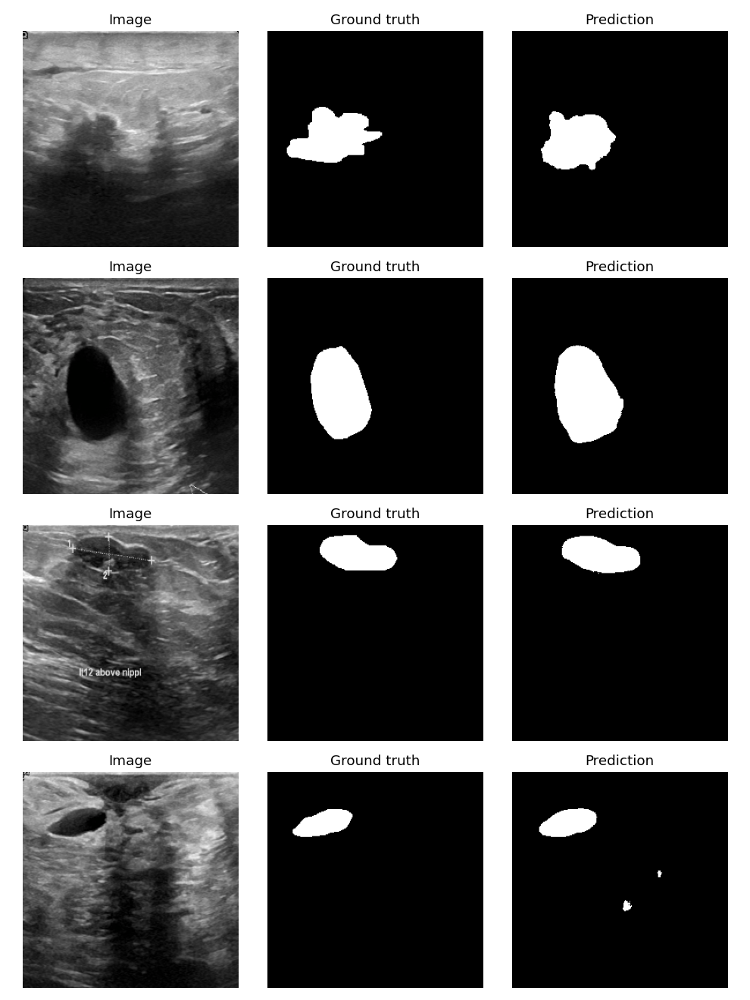
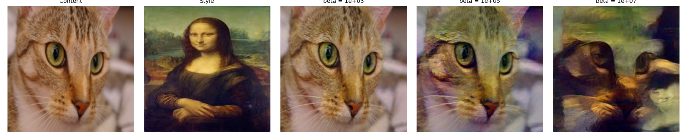
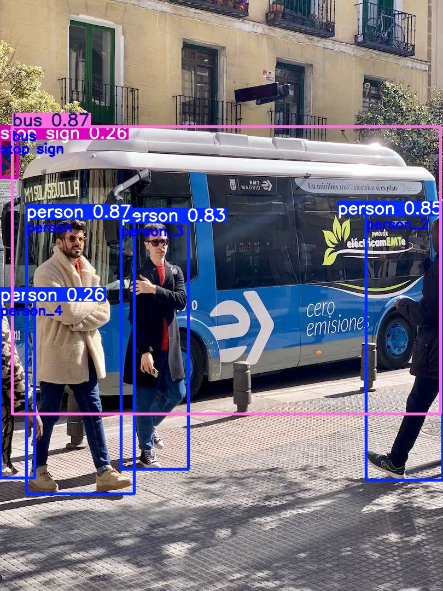
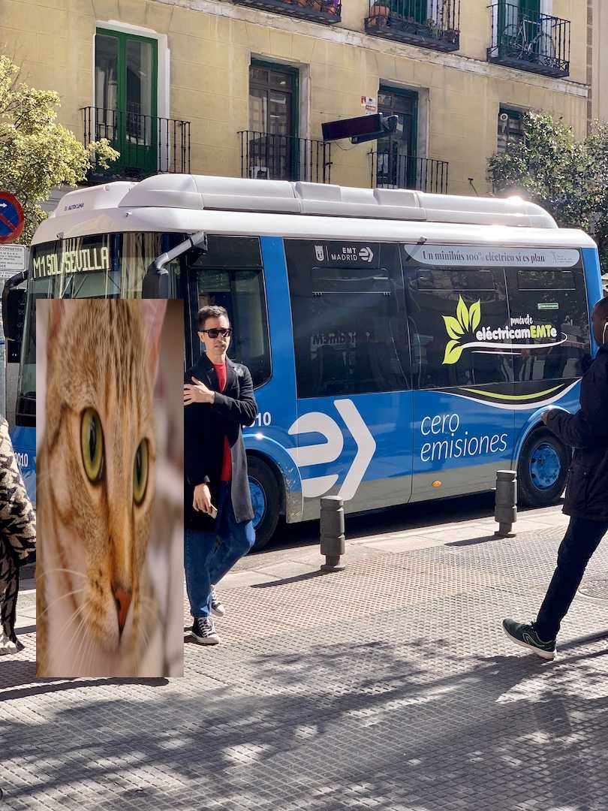
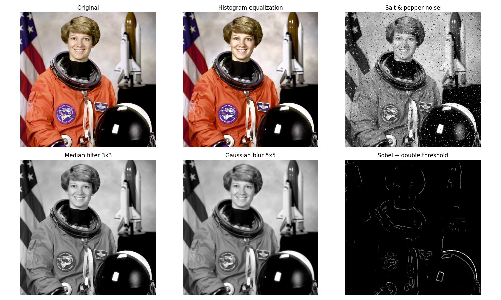

# PyTorch Computer Vision

Computer vision projects in PyTorch: image classification on CIFAR-10, medical image segmentation with U-Net,
neural style transfer, YOLOv8-based object replacement and classical image filters implemented from scratch.

All experiments run end-to-end from one [Colab notebook](notebooks/colab.ipynb) on a free T4 GPU;
metrics and figures are saved to [`results/`](results).

[](https://colab.research.google.com/github/sadwavesss/pytorch-computer-vision/blob/main/notebooks/colab.ipynb)

## Results

### CIFAR-10 classification (test set, 10 000 images)

| Model | Parameters | Epochs | Test accuracy |
|---|---:|---:|---:|
| `cnn` (baseline) | 2.5M | 30 | 78.67% |
| `improved_cnn` | 3.4M | 40 | 86.87% |
| **`resnet`** | 2.8M | 40 | **92.82%** |
| ensemble (`improved_cnn` + `resnet`) | — | — | 91.25% |

- The residual network with OneCycle LR, Mixup/CutMix and label smoothing is the best model: +14 pp over the baseline
  with a similar number of parameters. Its validation accuracy was still growing at epoch 40, so a longer schedule would help.
- The ensemble is worse than ResNet alone: averaging with a noticeably weaker model pulls predictions down.
- The hardest class for every model is `cat` (57% → 84%), mostly confused with `dog`.



Confusion matrices: [cnn](results/classification/cnn_confusion_matrix.png) ·
[improved_cnn](results/classification/improved_cnn_confusion_matrix.png) ·
[resnet](results/classification/resnet_confusion_matrix.png) ·
[ensemble](results/classification/ensemble_confusion_matrix.png)

### BUSI lesion segmentation (validation set, 156 images)

| Metric | Value |
|---|---:|
| Lesion Dice | 0.684 |
| Lesion IoU | 0.520 |
| Mean IoU (lesion + background) | 0.737 |
| Mean Dice | 0.830 |

U-Net trained from scratch for 40 epochs (best epoch 36, ~14 min on a T4). The validation set was also used to pick the
best epoch, so the numbers are slightly optimistic.



### Style transfer, object replacement, classical filters



| YOLOv8 detections | First detected person replaced |
|---|---|
|  |  |



## Projects

### 1. CIFAR-10 classification — [`vision/classification`](vision/classification)

| Model | Architecture | Training setup |
|---|---|---|
| `cnn` | 3 conv-BN-ReLU-pool blocks, dropout, 2 FC layers | AdamW, basic augmentation, early stopping |
| `improved_cnn` | VGG-style: 2 convolutions per block, 3 FC layers with BatchNorm | AdamW + cosine LR, label smoothing, Mixup, stronger augmentation (RandomErasing, grayscale, scale) |
| `resnet` | ResNet with 3 stages × 2 residual blocks (64-128-256) | SGD Nesterov + OneCycle LR, label smoothing, Mixup + CutMix |
| ensemble | `improved_cnn` + `resnet` | averaged softmax probabilities |

Training uses an 80/20 train/validation split (validation for early stopping and checkpoint selection),
mixed precision on GPU, and reports test accuracy, per-class accuracy and confusion matrices.

### 2. Breast ultrasound segmentation (BUSI) — [`vision/segmentation`](vision/segmentation)

- U-Net (4 levels, 64→1024 channels, ~31M parameters) for lesion vs background segmentation.
- Dataset: [Breast Ultrasound Images](https://www.kaggle.com/datasets/sabahesaraki/breast-ultrasound-images-dataset)
  (benign, malignant, normal). Multiple masks per image are merged; benign and malignant lesions form one class.
- Loss: 0.5 × cross-entropy + 0.5 × soft Dice. Albumentations augmentation (flips, rotations, affine, brightness/contrast).
- Metrics: IoU and Dice accumulated over the whole validation set.

### 3. Neural style transfer — [`vision/style_transfer.py`](vision/style_transfer.py)

Gatys et al. approach: VGG19 features, content loss on `conv4_2`, weighted Gram-matrix style loss on
`conv1_1`…`conv5_1`, optimized with L-BFGS. The demo compares style weights β = 1e3, 1e5, 1e7.

### 4. Object detection and replacement — [`vision/detection`](vision/detection)

YOLOv8n detects objects, the selected object is removed with OpenCV inpainting (Telea) and another image is
alpha-blended into its bounding box.

### 5. Classical image processing — [`vision/classical`](vision/classical)

Implemented with NumPy and checked against OpenCV in tests: median filter, Gaussian blur, Sobel edges with double
thresholding, histogram equalization (luma channel for color images), red-cyan stereo anaglyph.

## Getting started

```bash
python -m venv .venv
# Windows: .\.venv\Scripts\activate    Linux/macOS: source .venv/bin/activate
pip install -r requirements.txt

python -m vision.classification.train --experiments cnn --epochs 2   # quick check
python -m vision.classification.train --experiments cnn improved_cnn resnet --ensemble improved_cnn resnet
python -m vision.segmentation.train --download
python -m vision.assets
python -m vision.style_transfer --content assets/chelsea.png --style assets/mona_lisa.jpg
python -m vision.detection.replace_object --image assets/bus.jpg --replacement assets/chelsea.png --target person
python -m vision.classical.demo --image assets/astronaut.png

pytest
```

## Project structure

```
vision/
  classification/   data.py, models.py, augment.py (Mixup/CutMix), train.py
  segmentation/     data.py (BUSI preparation, dataset), unet.py, metrics.py (losses, IoU/Dice), train.py
  detection/        replace_object.py
  classical/        filters.py, demo.py
  style_transfer.py
  assets.py         downloads freely licensed demo images
notebooks/colab.ipynb
results/            metrics (JSON) and figures from the Colab run
tests/
```

Demo images: scikit-image sample data, `bus.jpg` from ultralytics, and the Mona Lisa (public domain).
